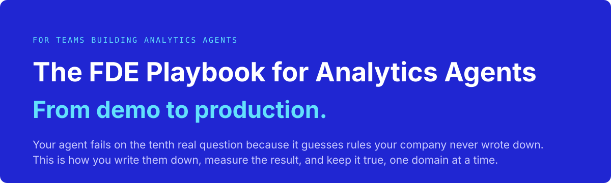
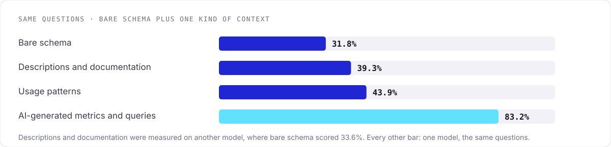
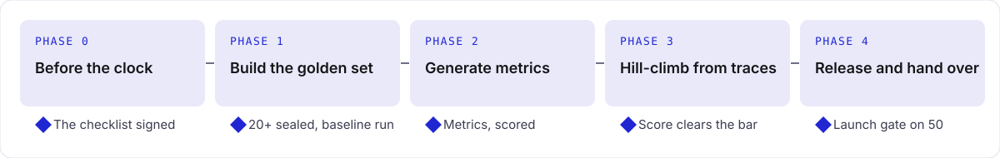

<p align="center">
  <picture>
    <source media="(prefers-color-scheme: dark)" srcset="assets/hero-dark.svg">
    
  </picture>
</p>

<p align="center">
  <a href="https://analytics-playbook.atlan.com/"><b>Read the guide</b></a> ·
  <a href="https://analytics-playbook.atlan.com/#start-map">The method on one map</a> ·
  <a href="https://analytics-playbook.atlan.com/#videos">Watch the videos</a> ·
  <a href="chapters/r0-results.md">What we found</a>
</p>

<p align="center">
  <a href="https://github.com/atlanai/analytics-playbook/actions/workflows/pages.yml"></a>
  
  
</p>

---

Analytics agents pass the demo and fail on the tenth real question. The wrong answers look right, so nobody notices until a number reaches a board deck.

This playbook shows how to fix that. It covers what the agent has to know, how to build that knowledge and measure it, and who does what, phase by phase, until your team runs the loop on its own. It is written for whoever does the work: your own team, a partner, or a forward-deployed engineer.

Prefer listening? [Choose a podcast for your role](https://analytics-playbook.atlan.com/#listen), 12–21 minutes each. Audio plays while you read; transcripts are available for every episode.

## The problem in one query

Ask an agent for fiscal Q3 sales pipeline, at a company whose fiscal year ends 30 June. Any good analyst writes this:

```sql
SELECT SUM(o.amount)
FROM opportunity o
JOIN account a ON a.id = o.account_id
WHERE o.close_date BETWEEN DATE '2026-01-01' AND DATE '2026-03-31'  -- fiscal Q3
  AND o.stage NOT IN ('Closed Won', 'Closed Lost')
  AND a.is_internal = FALSE AND a.is_test = FALSE;  -- internal and test accounts are out
```

It returns $18.4M. Finance reports $11.2M, because at this company the earliest pipeline stages are top-of-funnel noise and never count. That rule is in no table, no column and no description. Nothing in the wrong SQL looks wrong.

A business question like this hides about five such decisions: which stages count, which rows, which quarter, which amount, and how the answer is assembled. Guess each one right 80% of the time and you get all five right once in three tries: 0.8⁵ ≈ 33%. This is a worked example. Bare-schema agents in our runs scored near it. On our warehouse, switching models moved that score far less than adding context did.

## What moves accuracy

<p align="center">
  <picture>
    <source media="(prefers-color-scheme: dark)" srcset="assets/ladder-dark.svg">
    
  </picture>
</p>

We ran the method on our own go-to-market warehouse: 107 real questions our analysts had asked, graded by code. No person wrote the context behind these results: our systems built every metric, past query and term from the query log, the catalog and existing documentation.

- **Context moved the score more than the model did.** Adding context took one model from 31.8% to 83.2% on the same questions, with the metrics-layer configuration we ship. Switching models moved it far less.
- **Past SQL beats documentation.** Queries your analysts already ran carry the business rules. More documentation added a few points for about seven times the context, and a join graph added nothing.
- **SQL beats a sentence.** On multi-table questions, a metric served as SQL beat the same metric written as prose by 16 points.
- **Retrieve per question; don't load everything.** Served per question, the metrics layer scored 83.2%. Loaded whole into every prompt, it scored 52.3% and cost more than twice as much per right answer.
- **Provenance settles most conflicts.** When two definitions disagree, the one most analysts ran recently, and that matches the warehouse, usually wins. The owner settles the rest.

## The method

<p align="center">
  <picture>
    <source media="(prefers-color-scheme: dark)" srcset="assets/phases-dark.svg">
    
  </picture>
</p>

Work one domain at a time: scope, test, generate metrics, resolve conflicts, hill climb, release. Evals come first: the golden set is sealed before any context is built. The agent makes one context call per question, served live over MCP from one store. Two lanes set how exact each answer must be:

- **Governed lane:** the numbers the business runs on. They come from metrics, generated from your past SQL and BI, checked against the warehouse and approved by their owners. No metric, no answer.
- **Exploratory lane:** everything else. The agent writes SQL grounded in trusted past queries and shows its sources.

## Pick your door

| You are… | Recommended reading | Your cards |
|---|---|---|
| **Sponsoring it**: CDAO, VP Data or AI, exec sponsor | [The method at a glance](chapters/00-method.md), [Why analytics agents are hard](chapters/01-why-hard.md) and [Evals first](chapters/02a-evals-first.md). About 20 minutes, or the three-minute [overview video](https://analytics-playbook.atlan.com/#videos) | [The sponsor's ask](https://analytics-playbook.atlan.com/#c2) · [What the sponsor sees at each gate](https://analytics-playbook.atlan.com/#c10) · [Is it ready to launch?](https://analytics-playbook.atlan.com/#c12) |
| **Building it**: agent builder, context engineer, analytics engineer | [Evals first](chapters/02a-evals-first.md) → [The metric is the unit](chapters/02b-metric-unit.md) → [Serve per question](chapters/02c-serve-per-question.md) → [Phase 0](chapters/03-phase-0.md) → [Phases 1-4](chapters/04-week-1.md) → [Keep it running](chapters/08-after-launch.md) | [What you need before you start](https://analytics-playbook.atlan.com/#c11) · [Why did this miss?](https://analytics-playbook.atlan.com/#c6) · [How to resolve a conflict](https://analytics-playbook.atlan.com/#c5) |
| **Running it**: delivery lead, partner consultant, internal program lead | [The method at a glance](chapters/00-method.md) → [Phase 0](chapters/03-phase-0.md) → Phases 1-4 → the ceremonies and stalls in [Keep it running](chapters/08-after-launch.md) | [What you need before you start](https://analytics-playbook.atlan.com/#c11) · [The eval owner's week](https://analytics-playbook.atlan.com/#c3) · [What to do when](https://analytics-playbook.atlan.com/#c9) · [Deliver as a partner](https://analytics-playbook.atlan.com/#c14) |

Cards are one-page checklists you can print. Not sure where you stand? Take the [self-assessment](https://analytics-playbook.atlan.com/#assess); it routes you to the chapters you need.

## What's inside

| | Chapter | What it answers |
|---|---|---|
| **Why it is hard** | [Why analytics agents are hard](chapters/01-why-hard.md) | The five steps and the open one; the tenth question; what the question means (five hidden decisions, the model swap); deciding the same way every time (SQL beats a sentence); knowing you are right (why a fixed test). Each ends with where its fix lives |
| **How to build one** | [The method at a glance](chapters/00-method.md) | What closes the gap (the context ladder), the lifecycle, the eight rules, the gates, the method map, the running example |
| | [Evals first](chapters/02a-evals-first.md) | One row of the golden set, what makes an eval worth trusting, grading in layers, evals as the agent's CI/CD |
| | [The metric is the unit](chapters/02b-metric-unit.md) | What a metric is, where each kind of knowledge goes, why a metric and not a view, the two lanes |
| | [Serve per question](chapters/02c-serve-per-question.md) | The retrieval architecture, why MCP, what the search should match, checking it in the traces |
| | [Phase 0: before the clock](chapters/03-phase-0.md) | One domain, access, agent architecture, people and hours |
| | [Phase 1: build the golden set](chapters/04-week-1.md) | Harvesting and grading at least 20 real questions, sealing them, the baseline |
| | [Phase 2: generate metrics](chapters/05-week-2.md) | Generating metrics from past SQL and BI, checking them, resolving conflicts, approving |
| | [Phase 3: hill-climb from traces](chapters/06-week-3.md) | Reading the raw trace, the three kinds of miss, the smallest fix, when to stop |
| | [Phase 4: release and hand over](chapters/07-week-4.md) | The launch gate, how the agent reaches users, and the handover |
| | [Keep it running](chapters/08-after-launch.md) | The production loop, drift triggers, domain two, answering why, the ceremonies and gates, what to do when things stall |
| **Toolkit** | [Where are you starting?](chapters/00-start.md) · [Cards](chapters/cards.md) · [Templates](chapters/r2-templates.md) · [Videos](chapters/videos.md) | The readiness self-assessment, 14 printable cards, 21 copy-paste templates and ten narrated videos, about 31 minutes in all |
| **Research** | [What we found](chapters/r0-results.md) · [How we measured](chapters/r3-evidence.md) · [What others found](chapters/r6-field-research.md) | Every result with its cost, the misses and why, the benchmark method, and outside research next to ours |
| **Reference** | [Failure modes](chapters/r1-failure-modes.md) · [Glossary](chapters/r4-glossary.md) · [Tooling](chapters/r5-tooling.md) · [Semantic layers compared](chapters/r7-semantic-layers.md) | A failure index you look up by symptom, the vocabulary, sources, how to contribute, and one model in six semantic-layer syntaxes |

The chapters follow one engagement, a sales domain, from the Phase 0 checklist to the domain-two plan, in boxes marked **In practice**. It is a composite built to show the method, so its counts are examples, not measurements.

## Use it

- **Read online:** the [published guide](https://analytics-playbook.atlan.com/), with diagrams, printable cards and checklists that remember your progress.
- **Listen or watch:** [three podcasts](https://analytics-playbook.atlan.com/#listen), about 46 minutes in all, and [ten narrated videos](https://analytics-playbook.atlan.com/#videos), about 31 minutes. The files are in [`media/`](media/).
- **Read on GitHub:** every chapter is plain Markdown in [`chapters/`](chapters/).

## A Note To Our Readers

We've been working on this problem since we were a data team ourselves. This playbook is our best attempt so far, not the final word. We've tried to show all our work: every result, how we measured it, and where it fell short. We'll keep updating it as we learn more, test new methods and as the AI ecosystem changes. If you build, lead or implement analytics agents, we want to hear what you find. [Get in touch](#contact).

## Contribute

Found something wrong, or have a field result to add? Open an issue or a pull request. The build check runs on every PR. It fails on broken links, unregistered evidence IDs, missing diagrams and banned phrasing.

- [CONTRIBUTING.md](CONTRIBUTING.md) sets the evidence rules. Give each number's source and scope in the PR description for maintainer review. Quote the configuration you ship, never the best run, and give the range of variants next to it.
- [AUTHORING.md](AUTHORING.md) covers the markup for scenes, cards, templates, diagrams and callouts.
- [CHANGELOG.md](CHANGELOG.md) records what changed in each version.

## Contact

Questions about the playbook, a result you want to share, or a correction? [Open an issue](https://github.com/atlanai/analytics-playbook/issues) or a pull request, or email Himanshu Sikaria at himanshu@atlan.com.

## FAQ

**Is this tied to a product?**
Atlan sells a context-layer product built around this method, and Atlan's systems built the benchmark context. Everything here can be built without it.

**Will the numbers transfer to my warehouse?**
The method transfers; your numbers will be your own. Expect the same order: past SQL beats documentation, and metrics add to both.

**How long does it take?**
Five phases for the first domain: Phase 0, often about two weeks, then four build phases, often a week each. A team with access in hand can move faster; the gates are what count. Phase 0 takes longer where vendor or security review applies.

---

<p align="center">Published by <a href="https://atlan.com">Atlan</a>. Maintained by the playbook maintainers.</p>

## License

The book (text, diagrams, cards, templates, evidence and media) is licensed under [CC BY 4.0](https://creativecommons.org/licenses/by/4.0/): copy and adapt it with credit. The build code is under the [MIT License](LICENSE). Product names are their owners' trademarks. See [LICENSE](LICENSE).
